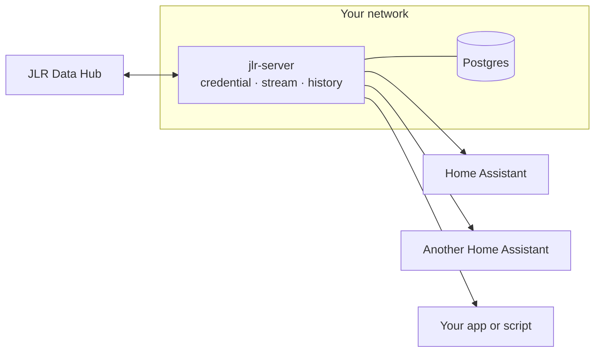

# jlr-server (proxy)

!!! abstract "Advanced and optional"
    You don't need this to use the integration. Set it up only if you want the car's data in **more than one place**,
    or want per-trip battery use and alerts. Otherwise [connect directly](../getting-started/connect.md).

## Why it exists

JLR allows **one Data Hub credential per account** ([why that matters](../how-it-works.md#one-credential-per-account)).
Whatever holds it is the only thing that can read the car. If you want:

- two Home Assistant instances (home and holiday home, or production and a test install), or
- Home Assistant **and** your own app, dashboard or script,

they can't each have a credential. jlr-server holds the one credential and acts as a **proxy**: it reads from JLR and
serves the data to any number of clients, each with your API token.



## What you get on top

| | Direct | jlr-server |
|---|---|---|
| Clients per car | one | any number |
| Live stream | yes, while Home Assistant runs | yes, always on |
| History of every report | Home Assistant's recorder | its own Postgres database |
| **Battery used per trip** | no | yes (`soc_start`, `soc_end`, `soc_used` on Last trip) |
| Charging sessions | no | yes (`/api/charges`) |
| Alerts (12 V battery, charging fault, fault codes) | build your own automations | built in, via the API (and optional Apple push for your own iOS app) |

**Battery per trip** works because the car reports when it's switched off. The server records every report, so the
battery % before a trip is the last report before it starts, and the % after is the first report once it ends. Trips
from before the server started have no battery figure.

## Run it

You need Docker with Compose, on a machine that's always on (a home server, a NAS, a small VM).

1. Get the code and make your settings:

    ```sh
    git clone https://github.com/leos-lab/ha-jlr-data-hub
    cd ha-jlr-data-hub
    cp server/.env.example server/.env
    ```

2. Edit `server/.env`. Fill in two random secrets:

    ```sh
    openssl rand -hex 32   # API_TOKEN: clients send this
    openssl rand -hex 24   # POSTGRES_PASSWORD
    ```

3. Start it (the server, plus a Postgres for its history):

    ```sh
    docker compose -f server/compose.yml up -d --build
    ```

    It listens on port **9293**. `curl http://localhost:9293/healthz` should answer `{"ok":true}`.

!!! tip "Already run Postgres?"
    Set `DATABASE_URL` in `server/.env` and remove the `db` service from `server/compose.yml`.

## Give it the JLR credential

Every call needs your token. In these examples `$T` is your `API_TOKEN` and `$S` is the server's address, e.g.
`http://localhost:9293`.

1. **Get its certificate.** The server makes its key on first start:

    ```sh
    curl -s -H "Authorization: Bearer $T" $S/api/certificate > jlr.pem
    ```

2. **Create the credential in JLR's data portal** with `jlr.pem`, exactly as in
   [Create your JLR credential](../getting-started/jlr-credential.md): [data.jlr.com](https://data.jlr.com/en_xi/index.html)
   → **Access your data** → **Private** → sign in → **Data Access Credentials**. Delete any existing one, then
   **Create Access Credential**: device-based, your car, every category. Also make a stream configuration with every
   signal.

3. **Tell the server about it**:

    ```sh
    curl -s -X PUT -H "Authorization: Bearer $T" -H "Content-Type: application/json" $S/api/config \
      -d '{"clientId": "<client ID>", "vin": "<VIN>", "streamUsername": "<stream username>", "accountId": "<account ID>"}'
    ```

4. **Sign in**:

    ```sh
    curl -s -X POST -H "Authorization: Bearer $T" $S/api/signin
    ```

    It answers with a `verificationUriComplete` link and a `userCode`. Open the link, sign in with your JLR account
    and approve. Check it worked:

    ```sh
    curl -s -H "Authorization: Bearer $T" $S/api/status
    ```

    `"signedIn": true`, and after a few seconds `"stream": {"state": "live", …}`.

From then on the server keeps the sign-in alive by itself. It fetches the latest every 10 minutes (which also renews
the sign-in) and new trips every 30 minutes, the first time going back 90 days.

## Connect Home Assistant to it

In Home Assistant, add **JLR Data Hub** and choose **Read from a jlr-server (advanced)**, with the server's address
and `API_TOKEN`. See [Through jlr-server](../getting-started/connect.md#through-jlr-server). Repeat on every Home
Assistant that should see the car.

## Reaching it from outside your home

Home Assistant on the same network can use the local address. For phones and anything away from home, put it behind
your usual HTTPS reverse proxy (Nginx Proxy Manager, Caddy, Traefik, a Cloudflare Tunnel) and use the `https://`
address. The API token protects every endpoint except `/healthz`.

## Keep it safe

| What | Where | Why it matters |
|---|---|---|
| JLR private key and sign-in | the `jlr-keys` volume | Anyone with it can read your car's data. Back it up privately |
| History, trips, alerts | the `jlr-db` volume (Postgres) | Your driving history and locations |
| `API_TOKEN` | `server/.env` | Lets anyone holding it read everything above |

To start over, delete the credential in the JLR portal and remove both volumes.

## Alerts

The server watches every report and opens an alert when one of these starts, closing it when the car reports it's
gone:

- 12 V battery low or empty
- 12 V battery health is *replace*, *recover* or *charge*
- 12 V battery below 11.9 V while parked
- a charging fault
- any fault code on the diagnostics stream (battery modules marked as warnings)

Read them from [`/api/alerts`](api.md). Optional Apple push to your own iOS app: mount a folder holding your
`AuthKey_<KEYID>.p8` at `/apns` and set `APNS_TEAM_ID` and `APNS_TOPIC` (your app's bundle ID).
