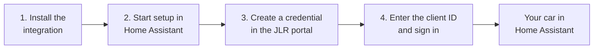

# Getting started

About 15 minutes, most of it in JLR's portal.

1. [**Before you start**](requirements.md): check your car and account are eligible.
2. [**Install the integration**](install.md) with HACS.
3. [**Create your JLR credential**](jlr-credential.md): Home Assistant gives you a certificate to upload.
4. [**Connect Home Assistant**](connect.md): enter the client ID and approve the sign-in.

!!! tip "Keep two tabs open"
    Setup goes back and forth: Home Assistant makes a certificate, you upload it to JLR's portal, then bring the client
    ID back to Home Assistant. Keep both open.
