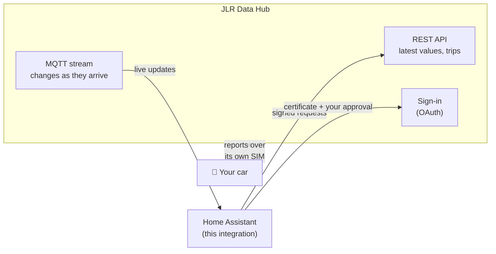
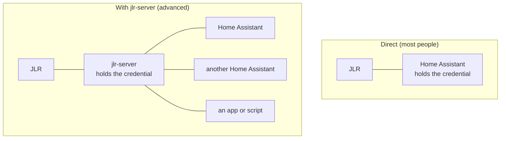

# How it works

## The pieces

1. **Your car** sends reports to JLR over its built-in connection (when you switch it off, while charging, and on some
   events).
2. **The JLR Data Hub** shares them with programs you've authorised, as a REST API (ask for the latest) and an MQTT
   stream (pushed as they arrive).
3. **This integration** holds the credential, signs in, fetches the latest every 10 minutes, listens to the stream,
   and turns JLR's signals into Home Assistant entities.

## How it proves who it is

The Data Hub uses no passwords between programs. Instead:

- **A key pair, made in Home Assistant.** The private key never leaves Home Assistant. You upload only the matching
  public certificate to JLR's portal, which is what creates the credential.
- **A signed sign-in.** Every time the integration asks JLR for access, it signs the request with that key (OAuth's
  `private_key_jwt`).
- **Your approval.** The first sign-in is a "device code" flow: you open JLR's page, sign in with your JLR account and
  approve. JLR then gives the integration tokens it renews by itself.
- **A proof with every request.** Each REST call carries a fresh signature tying it to Home Assistant's key (DPoP), so
  a stolen token is useless on its own.

All of it uses RSA keys with PS256 signatures (RSASSA-PSS, SHA-256), as JLR requires.

## One credential per account

This is the most important rule, and the reason [jlr-server](advanced/jlr-server.md) exists.

JLR allows **one Data Hub credential per account**. The credential is tied to one key, and the key lives in one
place. So only one program can read your car from JLR:

To read the same car from several places (two Home Assistants, or Home Assistant plus your own app), put
**jlr-server** in the middle. It holds the one credential and serves the data to everything else.

## What JLR's docs don't tell you

These were found against a real car. Where they differ from JLR's documentation, these are right:

| JLR's docs say | Real behaviour |
|---|---|
| Keep any MQTT client ID | The client ID must be the **stream username**, or the broker refuses the login |
| Subscribe to `…/vehicles/{vin}/#` | Wildcards below the VIN are refused. Subscribe to each `…/vehicles/{vin}/{category}` |
| (nothing) | Ask for one topic per subscribe, or the broker answers "quota exceeded" |
| Values have units | Every value arrives as text (`"90"`, `"LOCKED"`) without units |
| Odometer in km | It's in **metres** |
| Tyres in hPa | Usually **kPa** (values over 600 are hPa) |
| (nothing) | `-1` means "not set" |

The stream speaks MQTT 5, so refusals come back with a reason, and reconnects with a fresh token whenever the broker
drops it.
