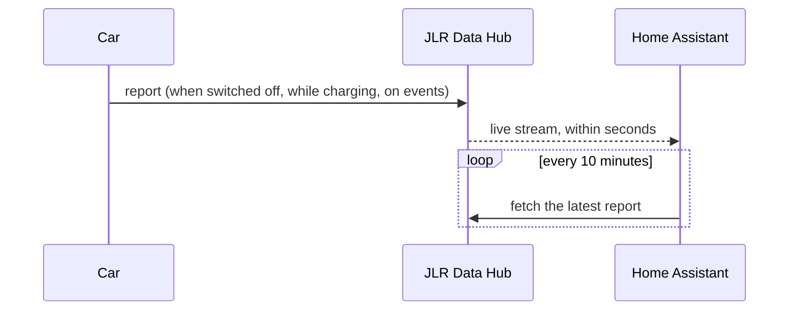

# How fresh is the data?

Home Assistant shows what **the car last reported**, and the car doesn't report all the time.

## When does the car report?

- **When you switch it off**: the end of every trip. Battery, range, location and locks all update.
- **While charging**: progress, time to full, energy added.
- **On some events**, such as locking, but with a delay. Locking an I-Pace showed up about **13 minutes** later in
  testing.

So after you lock the car, Home Assistant can still show it unlocked for a while. Check the **Last reported**
diagnostic to see how old the reading is.

!!! info "Nothing can make the car report sooner"
    JLR's own app can ask the car for a fresh report. The Data Hub can't, so no integration using it can either.

## Live stream or polling?

| | Live stream | Polling only |
|---|---|---|
| When reports arrive | within seconds of reaching JLR | within 10 minutes |
| Needs | a stream configuration in the portal and its username | nothing extra |

The stream reconnects itself. JLR's streaming passwords last about 5 minutes and its broker drops connections now
and then, so brief **Stream: connecting** moments are normal.
